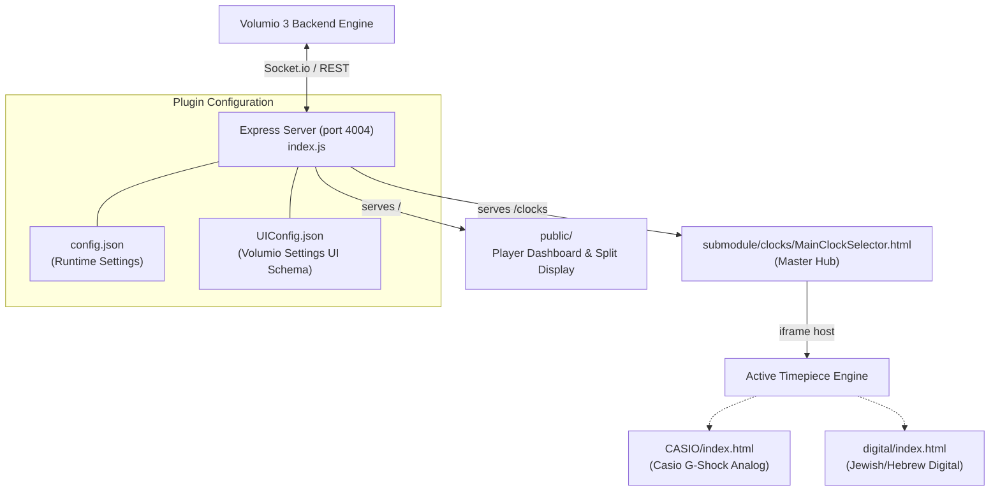

# Volumio CoreZoneDisplay — Complete Architecture & Plugin Wiki

## 1. System Overview

Volumio CoreZoneDisplay is a specialized display plugin for Volumio 3 that combines a music player dashboard with an offline, multi-runtime screensaver clocks suite.



---

## 2. Directory Structure

```text
volumio-CoreZoneDisplay/
├── config.json                   # Volumio plugin configuration values
├── UIConfig.json                 # Volumio settings UI template schema
├── index.js                      # Main plugin server (Express on port 4004, Socket.io client)
├── package.json                  # Node.js manifest and dependencies
├── install.sh / uninstall.sh     # Volumio plugin lifecycle scripts
├── public/                       # Main Volumio web player frontend
│   ├── index.html                # Player dashboard HTML
│   ├── style.css                 # Player styling
│   ├── app.js                    # Player logic & Volumio websocket integration
│   └── fonts/                    # Bundled offline fonts
├── submodule/clocks/             # Standalone screensaver clocks suite (Git Submodule)
│   ├── README.md                 # Clocks submodule overview
│   ├── WIKI.md                   # Detailed clocks architecture wiki
│   ├── AI_MANUAL.md              # Continuity guide for AI agents
│   ├── MainClockSelector.html    # Master hub & iframe stage
│   ├── assets/fonts/             # Local offline fonts (Google Sans, Press Start 2P)
│   ├── CASIO/                    # Authentic Casio G-Shock analog engine
│   └── digital/                  # Jewish/Hebrew digital calendar timepiece
└── win-debug/                    # Local Windows development & debugging scripts
```

---

## 3. Plugin Architecture (`index.js`)

- **Port**: Serves HTTP on port `4004` (e.g., `http://localhost:4004`).
- **Static Routes**:
  - `app.use('/clocks', express.static(clocksDir))` mounts `submodule/clocks`.
  - `app.use(express.static(publicDir))` mounts `public/`.
- **Display Modes**:
  - `screensaver_only`: Directly renders the selected clock fullscreen.
  - `full_ui`: Shows Volumio player controls, track info, and switches to screensaver on idle timeout.
- **Clock Scanning**: Automatically scans `submodule/clocks` for HTML files and seeds `MainClockSelector.html` as the default in Volumio's UI dropdown.
- **Auto Git Submodule Init**: If `submodule/clocks` is empty after deployment, `index.js` automatically executes `git submodule update --init --recursive`.

---

## 4. Clocks Submodule Integration

For complete details on the clocks submodule, see:
- **[submodule/clocks/WIKI.md](file:///C:/github_harelsh/volumio-CoreZoneDisplay/submodule/clocks/WIKI.md)**
- **[submodule/clocks/AI_MANUAL.md](file:///C:/github_harelsh/volumio-CoreZoneDisplay/submodule/clocks/AI_MANUAL.md)**
- **[submodule/clocks/CASIO/TIMEPIECE_ENGINEERING_MANUAL.md](file:///C:/github_harelsh/volumio-CoreZoneDisplay/submodule/clocks/CASIO/TIMEPIECE_ENGINEERING_MANUAL.md)**
