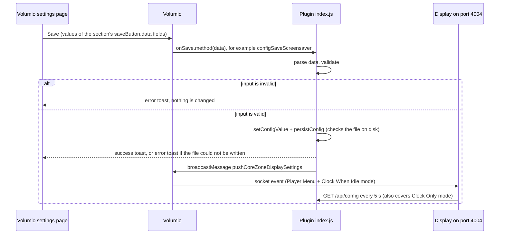

# Volumio Plugin Settings — How They Work

Knowledge base for the **CoreZoneDisplay** settings page: how a Volumio plugin shows, saves and applies settings, what can go wrong, and how to find out why a value did not stick.

It was written from three sources, all read in full:

- the **volumio-now-playing** plugin (local copy `C:\github_harelsh\volumio-now-playing`) — a working plugin with a large settings page, used as the reference;
- the **v-conf** library that stores plugin settings (`node_modules/v-conf`, version 1.4.3);
- our own reproductions and tests in [`win-debug/test-volumio-settings.js`](../win-debug/test-volumio-settings.js).

Anything about Volumio's own internals that was **not** verified in these sources is marked *(usual Volumio behaviour — confirm on the device)*.

---

## 1. The Pieces

| File | Role | CoreZoneDisplay | now-playing |
| :--- | :--- | :--- | :--- |
| `package.json` | Plugin name and type. The name is part of the save endpoint. | `core_zone_display`, `user_interface` | `now_playing`, `user_interface` |
| `UIConfig.json` | Layout of the settings page: sections, fields, Save buttons. | 5 sections | ~40 sections |
| `i18n/strings_en.json` | All texts. `UIConfig.json` refers to them as `TRANSLATE.KEY`. Other languages: `strings_<code>.json`, English is the fallback. | yes | yes |
| `config.json` | Where the values are kept (read and written through v-conf). | typed defaults, seeded on first start | **empty file** — defaults live in code |
| `index.js` | Builds the page (`getUIConfig`), receives Save (`configSave*`), stores values. | yes | `src/index.ts` |

---

## 2. What Happens When You Press Save

What the plugin receives in `data` (checked in both plugins' `parseConfigSaveData`):

- an object keyed by **field id**, containing only the fields listed in that section's `saveButton.data`;
- `select` fields arrive as `{ value, label }` — unwrap `.value`;
- switches arrive as booleans; number boxes may arrive as a number **or as text** (our tests send both).

---

## 3. `UIConfig.json` Rules

Checked automatically by `node win-debug/test-volumio-settings.js`.

- A section is `{ id, element: "section", label, description, icon, onSave, saveButton, content[] }`. (`description` is used by now-playing too.)
- `onSave` is `{ "type": "controller", "endpoint": "user_interface/<package name>", "method": "<method on the plugin>" }`. The endpoint must match `package.json` `name`, and the method must exist on the plugin class.
- **Every field that should be saved must be listed in the section's `saveButton.data`.** A field missing there is never sent (this is why "Not While Music Is Playing" once never saved).
- One handler per section (`configSaveDisplay`, `configSaveScreensaver`, `configSaveClock`, `configSaveRadio`), each saving only its own fields. Do not save the whole config from one section — it would overwrite the others.
- `visibleIf` only works on a field in the **same section** and is evaluated in the browser; the server does not need to know about it.
- A `select` field's `value` must be one of its `options`.
- All texts go through `TRANSLATE.KEY`; the test fails if a key is missing from `strings_en.json`.
- Labels are plain language. No "Setting 1/2/3", no open/close switches.

---

## 4. How v-conf Stores Settings

Facts from the v-conf 1.4.3 source (`node_modules/v-conf/index.js`):

| Behaviour | Consequence |
| :--- | :--- |
| Every value is an entry `{ "type": "number", "value": 60 }`. | A value stored in any other shape (for example a plain `60`) is **silently ignored** by `set()`: nothing changes, nothing is reported. |
| `set()` on an existing entry coerces to the entry's type; a number entry **throws** if the value is not numeric. | A text typed into a number field must be validated *before* storing. |
| `set()` schedules an autosave after 1000 ms, only when a file path is known. `save()` writes only if something changed. | Values reach the disk about a second later unless `save()` is called. |
| Defaults: `syncSave = true`, `atomicSave = false`. | The file is rewritten in place: a power cut while writing can leave a broken file. |
| **`save()` catches write errors and only prints "Configuration write error" to the console.** | If the file cannot be written, the plugin still holds the new value in memory, so everything *looks* saved — until Volumio restarts and the old value comes back. |
| `loadFile()` on a missing or unreadable file silently starts with an empty config. | A corrupt file turns every setting back into its default, without any message. |

### The ways "60 → 5" can fail to stick

All reproduced with the plugin code from before the fix (`repro` scenarios, now permanent tests):

| Situation | What happened | Message shown |
| :--- | :--- | :--- |
| Stored entry in the wrong shape (plain `60`) | stayed 60 in memory **and** on disk | "Settings saved" |
| Empty, text or invalid wait time | silently replaced by the default 60 | "Settings saved" |
| Config file not writable | 5 in memory, 60 on disk → reverts after a restart | "Settings saved" |
| Corrupt config file at start | all settings back to defaults | none |

A normal save of 5 always worked, which is why a quick test does not show these.

### How the reference plugin avoids most of this

- `config.json` ships **empty**. All defaults live in code (`PLUGIN_CONFIG_SCHEMA`); reading returns the stored value if the key exists, otherwise the code default. There is no pre-typed file whose shape can go wrong.
- A whole group of settings is stored as **one JSON string** under one key (`screen.idle`, `theme`, …), so a group is read and written as a unit.
- It does **not** check that the write succeeded.

### What CoreZoneDisplay does

- Keeps its code defaults (`getCurrentSettings()`), plus a typed `config.json` that is seeded on first start and back-filled for missing keys.
- `setConfigValue(key, value)` repairs a wrongly shaped or wrongly typed entry before calling v-conf.
- `persistConfig(expected)` calls `save()`, **reads the file back**, and if the value is not there writes the file directly — which also gives the real error text.
- `saveSettings()` shows the success message **only** when the file holds the new values; otherwise an error toast with the file path and reason.

---

## 5. Patterns Taken From now-playing

| Topic | now-playing | CoreZoneDisplay |
| :--- | :--- | :--- |
| Save handler per section | `configSave*` | same: `configSaveDisplay`, `…Screensaver`, `…Clock`, `…Radio` |
| Unwrapping `{value,label}` | `#parseConfigSaveData` | `parseConfigSaveData` |
| Invalid input | error toast, **return without saving** (wait time under 10 s) | same: wait time under 5 s or not a number → error toast `ERR_IDLE_TIMEOUT`, nothing changes. Before, it was silently reset to 60. |
| Texts in toasts | `getI18n('NOW_PLAYING_SETTINGS_SAVED')` from `strings_<lang>.json`, English fallback | `getText('SETTINGS_SAVED')` — same lookup |
| Telling the open screens | `broadcastMessage('nowPlayingPushSettings', …)` | `broadcastMessage('pushCoreZoneDisplaySettings', …)` + 5 s poll of `/api/config` |
| Refreshing the settings page (`pushUiConfig`) | **only when the page must change** (e.g. a switch that shows or hides parts of the page, decided on the server) | after every successful save (kept from an earlier attempt). Harmless, but not needed: our `visibleIf` is evaluated in the browser. |
| Checking that the write worked | no | yes (`verifyConfigOnDisk`) |

---

## 6. When a Setting Does Not Save — Checklist for the Pi

1. **Is the new code running?** Volumio loads plugin code when it starts. After copying new files, restart Volumio (for example `volumio vrestart`) *(usual Volumio behaviour — confirm on the device)*. Quick test: after pressing Save, the toast now reads **"Settings saved successfully"**; the old code said just "Settings saved".
2. **Open `http://<pi-ip>:4004/api/debug`** and look at `configFile`:

   | Field | Meaning |
   | :--- | :--- |
   | `file` | The config file actually used (usually under `/data/configuration/user_interface/core_zone_display/` *(confirm)*) |
   | `exists`, `writable`, `validJson` | All three must be `true` |
   | `idleTimeoutSecInMemory` / `idleTimeoutSecOnDisk` | Must be equal. Different → the file is not being written |
   | `lastSave` | `{ at, source, ok, error, changes }` of the last save. `source` tells which button or API call it was |
   | `store` | `v-conf` normally; `built-in fallback` means Volumio's v-conf could not be loaded |

3. **Read the log**: `journalctl -u volumio -f | grep CoreZoneDisplay` *(service name usual — confirm)*, then press Save. Lines to expect:
   - `configSaveScreensaver received {…}` — Volumio called the plugin, and this is exactly what it sent;
   - `configSaveScreensaver saved to <file> -> {…}` — success;
   - `could NOT save to <file>: <reason>` — the file problem, with the reason;
   - `rejected wait time …` — the input was refused (the error toast says the same).

   **No `received` line at all** → the plugin method is not being called: old code still running, or `onSave.endpoint`/`method` in `UIConfig.json` does not match the plugin.
4. **Remember what the setting does.** The idle wait is used only in **Player Menu + Clock When Idle** mode (and the clock does not appear while music plays if "Not While Music Is Playing" is on). In **Clock Only** mode the clock is always shown, so changing the wait has no visible effect. The display picks up a saved change within about 5 seconds.

---

## 7. Adding a Setting — Checklist

1. `UIConfig.json`: add the field to the right section **and** to that section's `saveButton.data`.
2. `i18n/strings_en.json`: label, `_DOC` text, and an `ERR_…` text if it can be invalid.
3. `index.js`: default in `getCurrentSettings()`; fill the field in `getUIConfig()`; validate and add to `changes` in `saveSettings()`; same in `applyApiUpdate()` for the in-app view.
4. Use `setConfigValue` and `persistConfig` — never call `self.config.set()` directly in a handler.
5. `public/app.js`: read it in `applyConfigObject()`.
6. Add a case to `win-debug/test-volumio-settings.js`, run it, and also run `win-debug/validate-all.js`.

---

## 8. Source Files Studied (volumio-now-playing)

| File | What it showed |
| :--- | :--- |
| `src/UIConfig.json` | Section structure, `onSave` / `saveButton.data`, `description`, the idle-screen section |
| `src/index.ts` | `configSave*` handlers, `#parseConfigSaveData`, validation with error toast, conditional `refreshUIConfig`, lifecycle (`onVolumioStart`, `onStart`, `getConfigurationFiles`) |
| `src/lib/NowPlayingContext.ts` | `getConfigValue` / `setConfigValue`, `toast`, `getI18n`, `refreshUIConfig`, language-change reload |
| `src/lib/config/PluginConfig.ts` | Defaults in code, one JSON string per settings group |
| `config.json` | Empty (0 bytes) |
| `src/i18n/strings_en.json` | Text keys, including the error texts |
