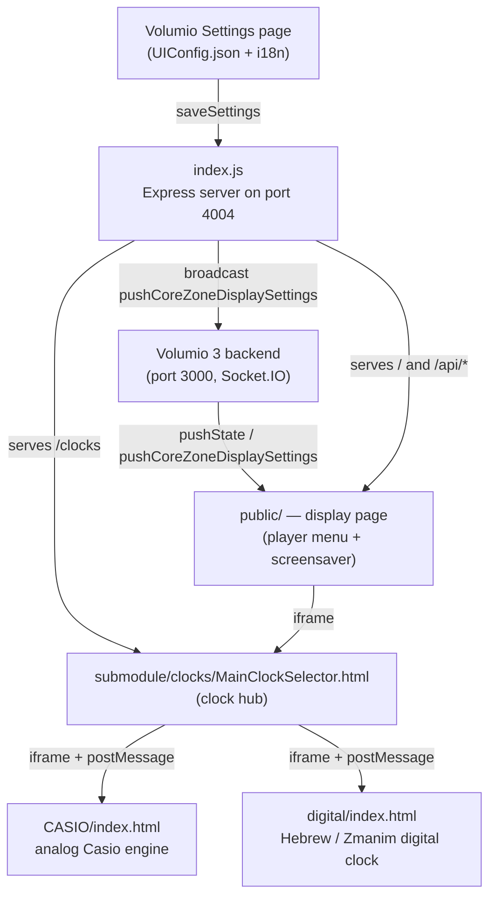

# Volumio CoreZoneDisplay — Wiki

CoreZoneDisplay is a Volumio 3 plugin that turns a screen (Raspberry Pi touchscreen, HDMI TV, kiosk browser) into a music player dashboard with a full-screen clock screensaver. The clocks live in a separate repository ([ClockWeb](https://github.com/HarelShriki/ClockWeb)) that is included as a git submodule.

> AI agents: read [AI_MANUAL.md](AI_MANUAL.md) first — it has the rules and checks for working in this repo.

---

## 1. How It Fits Together



| Part | Where | What it does |
| :--- | :--- | :--- |
| Plugin server | [`index.js`](../index.js) | Express on port **4004**: serves the display, the clocks and a small JSON API; builds the Volumio settings page and saves its values. |
| Volumio settings page | [`UIConfig.json`](../UIConfig.json), [`i18n/strings_en.json`](../i18n/strings_en.json) | Plugin page inside Volumio → Plugins → CoreZoneDisplay. |
| Display page | [`public/`](../public/) | Player menu (sources, radio, Spotify, CD, podcasts, now playing, in-app settings) and the screensaver that shows the clock. |
| Clocks | [`submodule/clocks/`](../submodule/clocks/) | Clock hub plus the Casio analog and digital clocks. Separate git repo. |
| Windows dev tools | [`win-debug/`](../win-debug/) | Zero-dependency local server, helper scripts and tests. |

---

## 2. Directory Map

```text
volumio-CoreZoneDisplay/
├── index.js               # Plugin: Volumio lifecycle, Express server, settings, API
├── UIConfig.json          # Volumio settings page layout (5 sections)
├── i18n/strings_en.json   # Text for the settings page
├── config.json            # Default plugin config values
├── package.json           # Volumio plugin manifest (type: user_interface)
├── install.sh / uninstall.sh
├── public/                # The display page
│   ├── index.html         # Views: home, radio, spotify, cd, podcasts, settings, nowplaying + screensaver
│   ├── app.js             # Logic: Volumio socket, idle timer, settings sync, radio, podcasts
│   ├── style.css
│   └── fonts/             # Local fonts (Google Sans, Press Start 2P) — no CDN
├── submodule/clocks/      # ClockWeb git submodule (see section 6)
├── win-debug/             # Local Windows testing (see section 8)
└── wiki/                  # This documentation
```

---

## 3. Display Modes & the Idle Clock

| Mode (`displayMode`) | Shown in Volumio as | Behaviour |
| :--- | :--- | :--- |
| `screensaver_only` (default) | **Clock Only** | The clock is always on screen. Tapping it shows a floating toolbar for 5 seconds; it never returns to the player menu. |
| `full_ui` | **Player Menu + Clock When Idle** | Shows the player menu and connects to Volumio. After `idleTimeoutSec` seconds without touch/mouse/keyboard activity, the clock appears. Tapping the clock returns to the menu. |

Idle clock rules in `full_ui` (implemented in `resetIdleTimer()` in [`public/app.js`](../public/app.js)):

- `screensaverEnabled = false` → the clock never appears by itself (the **Show Clock** button still works).
- `preventScreensaverWhilePlaying = true` → no clock while Volumio's status is `play`; the timer starts again when playback is paused or stopped. This matches the idle-screen rule in volumio-now-playing (idle only when *both* the player and the user are inactive).
- Starting playback while the clock is showing switches back to the menu (when suppression is on).

---

## 4. Settings

There are two places to change settings. Both write to the same plugin config.

### 4.1 Volumio settings page

Volumio → Plugins → Installed → CoreZoneDisplay → Settings. Five sections, each with its own **Save** button that saves **only that section's fields**:

| Section | Fields (config key) |
| :--- | :--- |
| **Display Mode** | Startup Screen (`displayMode`) |
| **Idle Clock (Screensaver)** | Show Clock When Idle (`screensaverEnabled`), Not While Music Is Playing (`preventScreensaverWhilePlaying`), Wait Before Showing Clock (`idleTimeoutSec`) — the last two are hidden while the first is off |
| **Clock Face** | Clock (`selectedClock`) — options are found by scanning `submodule/clocks` |
| **Favorite Radio Stations** | Station 1–5 name/stream URL (`radio1Name`, `radio1Url` … `radio5Url`) |
| **Web Addresses** | Read-only links to the display page and the digital clock customizer, filled with the device's real IP |

How it works in [`index.js`](../index.js):

- `getUIConfig()` loads `UIConfig.json` through Volumio's `i18nJson`, flattens the fields of all sections, and fills in the current values.
- Each section's Save button calls its own handler (`configSaveDisplay`, `configSaveScreensaver`, `configSaveClock`, `configSaveRadio`), and all four go through `saveSettings(data, source)`.
- `saveSettings()` changes only the keys present in `data`, and:
  - **rejects bad input** — a wait time that is empty, not a number, or under **5 seconds** shows the error "Wait Before Showing Clock must be a whole number of seconds, at least 5. Nothing was changed." (it used to be silently replaced by 60);
  - stores each value with `setConfigValue()`, which repairs a wrongly shaped or typed entry;
  - **checks the file on disk** with `persistConfig()`; the message **"Settings saved successfully"** appears only when the file really holds the new values, otherwise an error toast names the file and the reason;
  - records the result in `lastSave` (shown by `/api/debug`) and logs it, then calls `notifySettingsChanged()`.
- All toast texts come from `i18n/strings_en.json` through `getText()`.

Full explanation, the reproduced failure cases and the Pi troubleshooting steps: **[VOLUMIO_PLUGIN_SETTINGS_GUIDE.md](VOLUMIO_PLUGIN_SETTINGS_GUIDE.md)**.

### 4.2 In-app settings

The **Settings** view inside the display page edits the same values and saves with `POST /api/config`.

### 4.3 Live updates (no reload needed)

Modelled on volumio-now-playing's `nowPlayingPushSettings`:

1. After any save, the server calls `commandRouter.broadcastMessage('pushCoreZoneDisplaySettings', settings)`.
2. The display listens for that socket event (in `full_ui` mode, where it is connected to Volumio).
3. The display also polls `GET /api/config` every 5 seconds — this covers **Clock Only** mode, which does not open a Volumio socket.
4. `applyConfigIfChanged()` applies a config only when it differs from what is already on screen, so polling never interrupts the user.

---

## 5. HTTP API (port 4004)

| Method & path | Purpose |
| :--- | :--- |
| `GET /api/config` | Current settings: `displayMode`, `screensaverEnabled`, `preventScreensaverWhilePlaying`, `idleTimeoutSec`, `selectedClock`, `availableClocks`, `radioStations`, `podcastFeeds` |
| `POST /api/config` | Partial update (JSON body, any of the keys above; `radioStations` as an array of `{name, url}`). Returns `{status: "ok", config}` and broadcasts the change. If the config file cannot be written it answers **HTTP 500** `{status: "error", message}` instead. An invalid `idleTimeoutSec` is ignored. |
| `GET /api/debug` | Runtime diagnostics for checking a Raspberry Pi install. `configFile` shows the config file path, whether it exists / is writable / is valid JSON, the wait time in memory and on disk, and the result of the last save. |
| `GET /api/podcasts/episodes?url=<rss>` | Fetches and parses a podcast RSS feed (latest 10 episodes) |
| `/clocks/*` | Static files from `submodule/clocks` (404 if the submodule is missing) |
| `/*` | Static files from `public/`, falling back to `index.html` |

The display talks to Volumio itself on `http://<host>:3000` (Socket.IO): it listens for `pushState` (player state) and `pushCoreZoneDisplaySettings`, and sends commands such as `play`, `pause` and volume.

---

## 6. Clocks Submodule (`submodule/clocks`)

Repository: `https://github.com/HarelShriki/ClockWeb.git`, path `submodule/clocks`.

```text
submodule/clocks/
├── MainClockSelector.html   # Clock hub: gallery, iframe stage, hot-switching, rotation, auto-roll
├── assets/fonts/            # Local Google Sans + Press Start 2P
├── CASIO/                   # Analog Casio G-Shock engine
│   ├── index.html / app.js / style.css / particles.js
│   ├── tools/analyze_markers.py
│   └── Watch/CASIO-GAC-2500-3A - VECTOR BW/   # png/ (real assets), map/ (marker images)
└── digital/                 # Digital clock with Hebrew calendar
    ├── index.html           # The clock
    ├── settings.html        # Visual customizer
    └── defult-1/2/3.json    # Built-in presets (spelling "defult" is intentional — used as IDs)
```

### 6.1 Clock hub — `MainClockSelector.html`

- Runs the active clock in `#clock-iframe`. Switching between clocks of the same family uses `postMessage` instead of reloading (no flicker).
- `CLOCK_REGISTRY` entries: `casio-vector-bw-strap`, `casio-vector-bw-dial`, `digital-defult-3`, `digital-defult-1`, `digital-defult-2`, `digital-custom`.
- Screen rotation 0°/90°/180°/270°, auto-roll carousel (Off/15s/30s/1m/5m), dark/light theme.
- Each Casio card has **◀ Left | ■ Center | Right ▶ | ↕ Scroll** position buttons.

### 6.2 Casio analog engine — `CASIO/`

- Model keys (`WATCH_MODELS` in `CASIO/app.js`): `CASIO-GAC-2500-3A-VECTOR-BW-STRAP` (with strap, 1088×1552) and `CASIO-GAC-2500-3A-VECTOR-BW-DIAL` (dial only, 1072×963).
- **Natural case**: the watch is never cropped into a circle.
- Smooth 3D drift (layered sine waves, fades in/out, frame-rate independent), glass shine masked to the watch outline, curved date window, Left/Center/Right alignment with edge inset (0–25%).
- Calibration drawer with 8 sections: zoom, center, small seconds dial, hour hand, minute hand, date window, motion & shine, screen position.
- Hotkeys: `A` cycle alignment, `L`/`C`/`R` align, `+`/`-` zoom, `0` reset zoom, `[`/`]` motion speed, `F` fullscreen; `M`/`Esc` toggles the hub menu.
- Deep math: [`CASIO/TIMEPIECE_ENGINEERING_MANUAL.md`](../submodule/clocks/CASIO/TIMEPIECE_ENGINEERING_MANUAL.md). Adding a model: [`CASIO/ADD_NEW_CLOCK_GUIDE.md`](../submodule/clocks/CASIO/ADD_NEW_CLOCK_GUIDE.md).

### 6.3 Digital clock — `digital/`

- 12h/24h time, Gregorian and Hebrew dates, holidays, weekly Parashah, candle-lighting/Havdalah, sunrise/sunset by city or coordinates.
- `settings.html` customizes colours, fonts, layout and zmanim; saves profiles and exports/imports JSON. Light theme uses grey backgrounds (`#e3e6ea`, `#eaecf0`, `#f2f4f6`) with black text.

### 6.4 `postMessage` messages

| Message | Direction | Payload |
| :--- | :--- | :--- |
| `CLOCKWEB_OPEN_SELECTOR` | clock → hub (also display → hub) | — |
| `CLOCKWEB_USER_ACTIVITY` | clock → hub | — |
| `CLOCKWEB_CASIO_MODEL_CHANGED` | clock → hub | `{ model }` |
| `CLOCKWEB_CASIO_ALIGN_CHANGED` | clock → hub | `{ model, align }` |
| `CLOCKWEB_PAGE_SCROLL_CHANGED` | clock → hub | `{ enabled }` |
| `CLOCKWEB_SET_CASIO_MODEL` | hub → clock | `{ model }` |
| `CLOCKWEB_SET_DIGITAL_CONFIG` | hub → clock | `{ config }` |
| `CLOCKWEB_SET_ALIGN` | hub → clock | `{ align: "left" \| "center" \| "right" }` |
| `CLOCKWEB_SET_ALIGN_INSET` | hub → clock | `{ inset }` (percent) |
| `CLOCKWEB_SET_PAGE_SCROLL` | hub → clock | `{ enabled }` |
| `CLOCKWEB_SET_THEME` | hub → clock | `{ theme: "dark" \| "light" }` |

### 6.5 Browser storage keys (`localStorage`)

| Key | Meaning |
| :--- | :--- |
| `clockweb_saved_clock_id_v1` | Startup clock ID |
| `clockweb_auto_launch_v1` | Hide the hub menu on start |
| `clockweb_allow_scroll_v1` | Page scroll on/off |
| `clockweb_auto_roll_sec_v1` | Auto-roll interval (seconds, `0` = off) |
| `clockweb_screen_rotation_v1` | `0` / `90` / `180` / `270` |
| `clockweb_theme_v1` | `dark` / `light` |
| `casioActiveModelKey` | Current Casio model |
| `casio_align_<model>` / `casio_inset_<model>` | Alignment and edge inset, per model |
| `casio_glare_side` / `casio_glare_intensity` | Glass shine settings |
| `webclockMinimalConfig` / `webclockSavedDesigns` | Digital clock config and saved designs |

These are per browser: settings made on one screen are not shared with another.

---

## 7. Fonts (100% Offline)

No page loads anything from the internet — no Google Fonts, CDN or remote `@import`. Verified with `node win-debug/check-fonts.js`.

| Font | Used by | How it is bundled |
| :--- | :--- | :--- |
| **Google Sans** | Display (`public/`), clock hub, Casio clock, digital settings | `.woff2` files (Latin + Hebrew) + `google-sans.css` in `public/fonts/` and `submodule/clocks/assets/fonts/` |
| **Press Start 2P** | Clock hub, digital clock "Retro arcade", digital settings | Embedded as base64 inside `press-start-2p.css` (same two folders) |
| **Carlito Offline** | Digital clock default text (Calibri look-alike) | Embedded as base64 in `digital/index.html` |
| **DSEG7 Retro** | Digital clock "retro" seven-segment digits | Embedded as base64 in `digital/index.html` (SIL Open Font License) |

Which page loads which font CSS:

| Page | Loads |
| :--- | :--- |
| `public/index.html` | `fonts/google-sans.css` |
| `MainClockSelector.html` | `assets/fonts/google-sans.css`, `assets/fonts/press-start-2p.css` |
| `CASIO/index.html` | `../assets/fonts/google-sans.css` |
| `digital/index.html` | `../assets/fonts/press-start-2p.css` + its own embedded Carlito/DSEG7 |
| `digital/settings.html` | `../assets/fonts/google-sans.css`, `../assets/fonts/press-start-2p.css` |

Other names in font lists (Segoe UI, Arial, Roboto, DIN Alternate, Symbola, Noto Sans Symbols, …) are only preferences: every list ends in a bundled font or a generic family (`sans-serif`, `monospace`), so text always renders offline.

---

## 8. Verification

These checks run on Windows without a Volumio device:

| Command (from repo root) | What it proves |
| :--- | :--- |
| `node win-debug/validate-all.js` | JSON files parse; JavaScript in the plugin and clocks has no syntax errors |
| `node win-debug/test-volumio-settings.js` | The Volumio settings page works: all `TRANSLATE.*` labels exist, field ids unique, `visibleIf` targets in the same section, select values valid, Save endpoint matches `package.json` name, clock list is scanned; saving each section the way Volumio does keeps the values, leaves other sections alone, shows a success toast, broadcasts to the screens, writes `config.json`, and `/api/config` returns the same values. **Plus the "60 → 5" cases:** 5 as a number and as text, survives a restart, a wrongly shaped or typed stored entry is repaired, empty / text / 0 / negative / under-5 input is rejected with an error and changes nothing, an unwritable file produces an error instead of "saved", a corrupt file at start does not block saving, in-app saves, `/api/debug` diagnostics |
| `node win-debug/check-fonts.js` | All fonts are offline (section 7) |

Last run: all three pass (68 settings checks). The real HTTP server was also exercised end to end on a temporary config copy (`GET/POST /api/config`, `/api/debug`, the display page, the clock hub, and the HTTP 500 on an unwritable file).

Still to confirm on a real Pi (not testable without Volumio + a browser): open the plugin settings, change e.g. **Wait Before Showing Clock**, save, and check that the open display at `http://<pi-ip>:4004` updates within ~5 seconds without a reload.

---

## 9. Install & Update on Volumio

1. Copy/clone the plugin to the Volumio device and install it as a user-interface plugin (`volumio plugin install` or the Volumio plugin upload).
2. If `submodule/clocks` is empty at start, `onStart()` runs `git submodule sync --recursive && git submodule update --init --recursive` automatically.
3. Open `http://<volumio-ip>:4004` in the kiosk/browser. The **Web Addresses** section of the settings page shows the exact links.

Updating the clocks: commit and push inside `submodule/clocks` first, then commit the new submodule pointer in this repo (`git add submodule/clocks`).

---

## 10. Local Development on Windows (`win-debug/`)

| File | Use |
| :--- | :--- |
| `start-local.bat` | Starts `dev-server.js` on port 4004 and opens the browser |
| `open-clock-only.bat` | Opens `/clocks/MainClockSelector.html` directly |
| `dev-server.js` | Zero-dependency server: serves `public/` and `/clocks/`, mocks `/api/config` (stored in `dev-config.json`) and the podcast endpoint. No Volumio socket — use **Clock Only** mode or test against a real Volumio. Set `PORT` to use another port. |
| `validate-all.js` | Checks JSON files and JavaScript syntax in the plugin and clocks |
| `test-volumio-settings.js` | Simulated Volumio settings test (see section 8); uses a temp copy of `config.json` |
| `check-fonts.js` | Offline font audit (see section 7) |
| `scan-assets.js`, `find-casio.js`, `download-google-sans.js`, `make-font-css.js` | Asset and font helper scripts |
