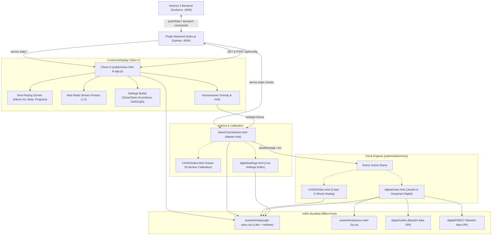

# Volumio CoreZoneDisplay & Clocks Hub — Master Wiki & AI Session Manual

A unified, offline, standalone audio player display interface and screensaver timepiece framework engineered for **Volumio 3** and dedicated kiosk/dashboard displays.

---

## 1. Executive Summary & Repository Map

This project consists of two integrated components:
1. **Volumio CoreZoneDisplay Plugin** (Parent repository): An Express web server running on port `4004` that connects to the Volumio 3 backend via Socket.io on port `3000`, providing playback control, album art display, Web Radio presets, and an automated idle screensaver.
2. **ClockWeb Screensaver Suite** ([submodule/clocks/](file:///C:/github_harelsh/volumio-CoreZoneDisplay/submodule/clocks/)): A modular, 100% offline, standalone clock engine hosting both authentic Casio G-Shock analog timepieces and a Hebrew/Gregorian digital calendar display.

```text
volumio-CoreZoneDisplay/
├── README.md                          # Root project overview & installation
├── wiki/                              # Comprehensive documentation repository
│   ├── project_wiki_and_ai_manual.md  # Master consolidated technical wiki & AI manual
│   ├── WIKI.md                        # Architectural specification & component breakdown
│   ├── AI_MANUAL.md                   # Operational guidelines, recipes & invariants
│   ├── VOLUMIO_COREZONE_DISPLAY_WIKI.md # Volumio-specific plugin documentation
│   ├── CLOCKS_HUB_README.md           # Clocks framework reference
│   ├── TIMEPIECE_ENGINEERING_MANUAL.md # Casio analog mathematical formulas & calibration
│   └── ADD_NEW_CLOCK_GUIDE.md         # Guide for adding new watch models
├── index.js                           # Volumio plugin backend (Express on port 4004)
├── config.json / UIConfig.json        # Volumio configuration schema and defaults
├── i18n/strings_en.json               # Localization strings
├── public/                            # Web client frontend (CarPlay / Naim Dark & Light UI)
│   ├── index.html                     # Player UI & collapsible settings modal
│   ├── style.css                      # Apple HIG compliant responsive design system
│   ├── app.js                         # Socket.io client, state machine & screensaver manager
│   └── fonts/                         # Bundled offline fonts (Google Sans, Press Start 2P)
└── submodule/clocks/                  # Standalone screensaver clocks suite (Git Submodule)
    ├── MainClockSelector.html         # Master hub, iframe stage, carousel & orientation host
    ├── assets/fonts/                  # Local offline fonts (Google Sans, Press Start 2P)
    ├── CASIO/                         # Authentic Casio G-Shock analog timepiece engine
    │   ├── index.html                 # Main analog timepiece application
    │   ├── style.css                  # 3D perspective, alignment, date curvature & glare styles
    │   ├── app.js                     # Watch engine, continuous 3D flow & glare physics
    │   ├── particles.js               # Interactive celestial canvas particle web
    │   └── Watch/                     # Modular timepiece models repository
    │       └── CASIO-GAC-2500-3A - VECTOR BW/  # Model folder (Strap & Dial variants)
    └── digital/                       # Minimal Jewish/Hebrew digital calendar timepiece
        ├── index.html                 # Digital clock runtime with Zmanim & Shabbat HUD
        ├── settings.html              # Visual real-time customizer (Dark & Light themes)
        └── defult-*.json              # Pre-configured digital design profiles
```

---

## 2. End-to-End System Architecture



---

## 3. Subsystem Specifications

### 3.1 Volumio Plugin Backend (`index.js`)
- Runs Express on **port 4004**, exposing:
  - `/` $\to$ Static files in [public/](file:///C:/github_harelsh/volumio-CoreZoneDisplay/public/)
  - `/clocks` $\to$ Static files in [submodule/clocks/](file:///C:/github_harelsh/volumio-CoreZoneDisplay/submodule/clocks/)
  - `GET /api/config` $\to$ Returns current settings JSON
  - `POST /api/config` $\to$ Updates settings and synchronizes with Volumio storage
- Dynamically discovers all clock `.html` files in `submodule/clocks/` for the Volumio selector dropdown.
- **Settings Structure & Schema (`UIConfig.json`)**:
  - `displayMode`: `'full_ui'` (Player + Screensaver) or `'screensaver_only'` (Standalone Clock Mode).
  - `screensaverEnabled`: Master switch for idle screensaver activation.
  - `preventScreensaverWhilePlaying`: **Suppresses screensaver while music is playing**, keeping album art and playback controls visible.
  - `idleTimeoutSec`: Inactivity countdown seconds (e.g., 30s, 60s, 300s).
  - `selectedClock`: Default clock HTML file launched inside the screensaver.
  - `radioStations`: 5 customizable web radio presets with instant streaming URLs.

### 3.2 Display Client & Screensaver Manager (`public/app.js`)
- **Real-Time Synchronization**: Connects to Volumio Socket.io on port 3000 for zero-latency status, volume, seek, and track metadata updates.
- **Playback-Aware Inactivity Watchdog**:
  - Tracks user activity (touches, clicks, keypresses).
  - In `full_ui` mode, starts `idleTimeoutMs` countdown only when no audio is playing or when `preventScreensaverWhilePlaying` is disabled.
  - Immediately wakes from screensaver to the Now Playing display when audio starts playing (`status === 'play'`).
  - When audio pauses or stops (`status === 'pause'` or `'stop'`), restarts the countdown timer to activate the screensaver after timeout.
- **CarPlay / Naim Dark & Light Themes**: Supported across all modal shells, inputs, buttons, and HUD overlays with `corezone_theme_v1` local persistence.

### 3.3 Master Clock Hub (`MainClockSelector.html`)
- **Zero-Flicker Transitions**: Switches between compatible clocks/presets via `postMessage` without reloading the iframe.
- **Hardware Display Rotation**: Supports $0^\circ, 90^\circ, 180^\circ, 270^\circ$ display rotation.
- **Auto-Roll Carousel**: Cycles through all 6 clock faces at customizable intervals (15s, 30s, 1m, 5m, Off).
- **Close Mode / Open Mode Layout**: Clean accordion settings displaying only section names and dynamic live status summaries.
- **Dual Theme Support**: Real-time Dark Theme ⇄ Light Theme toggle button in the header and settings row with `clockweb_theme_v1` persistence.
- **Default Typography**: Standardized on **Google Sans** for all UI titles, buttons, cards, and summaries.

### 3.4 Casio G-Shock Analog Framework (`CASIO/`)
- **Zero Circular Crop Policy**: Preserves authentic full rectangular and octagonal watch cases and resin straps without artificial `border-radius: 50%` cropping.
- **Dual High-Contrast Monochrome Models**:
  - `CASIO-GAC-2500-3A-VECTOR-BW-STRAP` ($1088 \times 1552$ full case with strap).
  - `CASIO-GAC-2500-3A-VECTOR-BW-DIAL` ($1072 \times 963$ edge-to-edge dial presentation).
- **Horizontal Alignment (Left / Center / Right)**: Shift clock horizontally with custom edge margin inset (0% to 25%), leaving viewport space for Volumio now-playing metadata, album art, or visualizers.
- **Harmonic Continuous 3D Motion**: Organic vector wander drift driven by layered incommensurate sine waves and frame-rate-independent exponential velocity damping.
- **Full-Clock Specular Glass Glare**: Realistic light sheen sweeping across the entire watch silhouette, dynamically tracking tilt with customizable light source side and intensity.
- **Circular Date Disc Curvature**: Simulates the genuine internal rotating 31-day date disc with radial chord and angle offsets at 3 o'clock.
- **8-Section Center Calibration Drawer**: Real-time tuning drawer with live SVG crosshairs and one-click JSON export.

### 3.5 Hebrew & Gregorian Digital Timepiece (`digital/`)
- Gregorian & Jewish calendar calculation: Jewish date, Zmanim, Shabbat entry/exit times, weekly Parashah, astronomical sun tracking.
- Interactive live settings editor ([digital/settings.html](file:///C:/github_harelsh/volumio-CoreZoneDisplay/submodule/clocks/digital/settings.html)) with Dark & Light theme support and Google Sans typography.
- Pre-configured profiles: Clean Dark (`defult-3.json`), Arcade Purple (`defult-1.json`), Amber CRT (`defult-2.json`), Matrix Terminal (`matrix`).

---

## 4. Communication Protocols & Storage Keys

### 4.1 `postMessage` Event Bus

| Event Type | Direction | Payload | Purpose |
| :--- | :--- | :--- | :--- |
| `CLOCKWEB_OPEN_SELECTOR` | Child $\to$ Parent | none | Request parent hub to open overlay menu |
| `CLOCKWEB_USER_ACTIVITY` | Child $\to$ Parent | none | Reset idle timer and wake parent HUD |
| `CLOCKWEB_CASIO_MODEL_CHANGED` | Child $\to$ Parent | `{ model }` | Synchronize model change in selector UI |
| `CLOCKWEB_CASIO_ALIGN_CHANGED` | Child $\to$ Parent | `{ model, align }` | Synchronize alignment buttons in selector UI |
| `CLOCKWEB_PAGE_SCROLL_CHANGED` | Child $\to$ Parent | `{ enabled }` | Synchronize scroll state in selector UI |
| `CLOCKWEB_SET_CASIO_MODEL` | Parent $\to$ Child | `{ model }` | Hot-switch Casio model inside active iframe |
| `CLOCKWEB_SET_DIGITAL_CONFIG` | Parent $\to$ Child | `{ config }` | Hot-switch digital preset configuration |
| `CLOCKWEB_SET_ALIGN` | Parent $\to$ Child | `{ align }` | Set horizontal alignment (`left`, `center`, `right`) |
| `CLOCKWEB_SET_ALIGN_INSET` | Parent $\to$ Child | `{ inset }` | Set edge inset margin percentage (0–25%) |
| `CLOCKWEB_SET_PAGE_SCROLL` | Parent $\to$ Child | `{ enabled }` | Toggle page scrolling (roll up/down) |
| `CLOCKWEB_SET_THEME` | Parent $\to$ Child | `{ theme }` | Switch color theme (`dark`, `light`) |

### 4.2 Key `localStorage` Identifiers

| Key | Scope | Purpose |
| :--- | :--- | :--- |
| `corezone_theme_v1` | Main Plugin | UI theme preference (`"dark"`, `"light"`) |
| `clockweb_saved_clock_id_v1` | Clocks Hub | Default clock ID launched automatically |
| `clockweb_auto_launch_v1` | Clocks Hub | Auto-launch default clock on startup (`"true"`, `"false"`) |
| `clockweb_theme_v1` | Clocks Hub | Interface theme preference (`"dark"`, `"light"`) |
| `clockweb_allow_scroll_v1` | Clocks Hub | Global page roll/scroll toggle state |
| `clockweb_auto_roll_sec_v1` | Clocks Hub | Carousel interval seconds (0, 15, 30, 60, 300) |
| `clockweb_screen_rotation_v1` | Clocks Hub | Screen rotation angle (0, 90, 180, 270) |
| `casioActiveModelKey` | Casio Clock | Active model (`CASIO-GAC-2500-3A-VECTOR-BW-STRAP`, etc.) |
| `casio_align_<modelKey>` | Casio Clock | Model-specific horizontal alignment (`left`, `center`, `right`) |
| `casio_inset_<modelKey>` | Casio Clock | Model-specific edge inset margin percentage |
| `casio_glare_side` | Casio Clock | Specular glare direction (`left`, `center`, `right`) |
| `casio_glare_intensity` | Casio Clock | Specular glare sheen intensity factor (0.0 to 1.0) |
| `webclockMinimalConfig` | Digital Clock | Active digital clock configuration JSON |
| `webclockSavedDesigns` | Digital Clock | Saved custom digital presets dictionary |

---

## 5. Invariants for AI Agents

1. **Natural Case Invariant**: Never apply circular cropping masks (`border-radius: 50%`) to the Casio watch case or dial.
2. **Asset Integrity Invariant**: Never overwrite, compress, or delete authentic PNG assets in `Watch/<model>/png/`.
3. **100% Offline Standalone (Zero-CDN)**: Never add external `<link>` or `<script>` tags pointing to remote CDN servers (`fonts.googleapis.com`, `cdnjs`, etc.). All assets must be bundled locally.
4. **Hot-Switch Invariant**: Prefer `postMessage` state updates over iframe reloads whenever switching between compatible models, themes, or alignments.
5. **Per-Model Independence**: Always store alignment, insets, and calibrations per model key.
6. **Playback Suppression Invariant**: When `preventScreensaverWhilePlaying` is enabled, the screensaver must remain suppressed while audio is playing.
7. **Apple HIG Compliance**: Maintain touch targets $\ge 44\text{px}$, typography $\ge 11\text{pt}$ ($0.72\text{rem}$), and contrast ratios $\ge 4.5:1$ for text elements.
8. **Submodule Git Discipline**: When updating clocks, commit inside `submodule/clocks` first, then commit the submodule pointer in the parent repository.

---

## 6. Pre-Flight Verification Commands

Run the comprehensive validation test suite before concluding any development turn:

```powershell
# 1. Full Syntax Validation (All JS, JSON, and inline HTML scripts)
node win-debug/validate-all.js

# 2. Asset Scanner (Ensures 0 external CDN dependencies)
node win-debug/scan-assets.js
```
